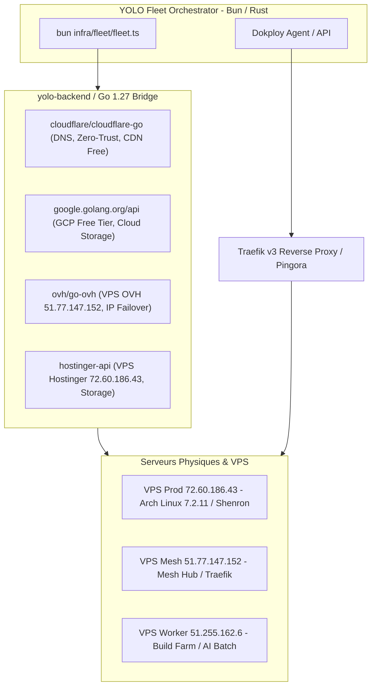

# Architecture Cloud Souveraine YOLO : Remplacement Open Source & Rust/Bun de Vercel, Cloudflare & Google Cloud

## 1. Vision et Objectifs Fondateurs

L'objectif est d'eliminer completement les couts recurrents et le vendor lock-in des plateformes proprietaires payantes (**Vercel, Cloudflare Paid Services, Google Cloud Platform, AWS, Netlify**) en assemblant une infrastructure **100% auto-hebergee, souveraine, haute performance et zero-dependance commerciale**.

Cette architecture capitalise sur :
1. **Dokploy (Multi-Server, Docker Swarm / Compose, Nixpacks, MCP AI)** pour l'orchestration PaaS self-hosted.
2. **Traefik (Go) & Pingora (Rust)** pour le routage dynamique L4/L7, SSL Let's Encrypt automatique et reverse proxy multi-cluster.
3. **Les SDKs Go officiels** (`cloudflare-go`, `google-cloud-go`, `ovh/go-ovh`, `hostinger-api`) integres sous [yolo-backend](file:///C:/src/yolo-backend) pour piloter l'infrastructure hybride (OVH, Hostinger, Cloudflare Free, GCP Free Tier).
4. **Les composants open source Rust et Bun** remplacant chaque fonctionnalite proprietary payante.

---

## 2. Matrice Exhaustive de Remplacement (Services Payants -> Equivalents Rust/Bun Open Source)

| Service Propriétaire Payant | Rôle Initial | Remplacement Souverain YOLO (100% Rust / Bun / Open Source) | Bénéfice Technique |
|---|---|---|---|
| **Vercel Pro / Enterprise** | Hébergement SSR Next.js, Edge Functions, Builds automatiques | **Dokploy + Nixpacks + Bun 1.4.4+ AOT / Dioxus 0.8 Fullstack + Axum** | Zero lock-in, SSR à froid en <5ms, compilation native sans Node.js. |
| **Cloudflare Workers / Pages** | Edge Compute JS / Serverless | **yolo-edge (Workerd open-source / Bun Server / Pingora Rust)** | Moteur d'isolation V8 V8-isolate local bare-metal ou binaire AOT Bun. |
| **Cloudflare R2 / AWS S3** | Stockage d'Objets & Distribution CDN | **Garage S3 (Rust) / MinIO + Caching NVMe Zstd local** | Stockage géodistribué léger écrit en Rust, compatible S3 API, zero egress fee. |
| **Cloudflare D1 / PlanetScale** | Base de données SQL distribuée / Edge SQL | **RQLite (Go Raft + SQLite) / Bun.sqlite WAL + Postgres Citus** | Consensus Raft distribué ultra-rapide, ACID, self-hosted sur notre cluster VPS. |
| **Cloudflare KV / Upstash Redis** | Cache clé-valeur distribué haute vitesse | **Bun.redis / DragonflyDB (C++ multithread) / Redis Rust** | 25x le débit de Redis mono-thread, compatible RESP3 direct. |
| **Cloudflare Queues / SQS** | Files de messages & streaming d'événements | **Iggy.rs (Rust) / NATS.io (Go)** | Streaming de messages haute performance écrit en Rust, latence microseconde. |
| **Cloudflare Tunnels (Payant/Teams)** | Zero Trust Access & Exposition privée | **WireGuard Kernel (`wg-quick`) + Rathole (Rust Reverse Proxy) / Traefik** | Réseau maillé chiffré Noise Protocol bare-metal, aucune dépendance externe. |
| **Google Cloud Run / Kubernetes** | Conteneurs serverless à la demande | **Dokploy + Docker Swarm / K3s (Rust/Go) + systemd-nspawn** | Démarrage immédiat sans cluster lourd, orchestration fluide multi-serveurs. |
| **Google Cloud Vertex AI / OpenAI** | Inférence LLM managée payante | **yolo-ai (llama.cpp C-ABI / carbon_ffi / Ollama / Gemma 4-bit)** | Inférence locale GPU/NPU uncensored, 0€ de coût par token. |
| **Google Cloud Pub/Sub** | Ingestion télémétrie & logs | **Vector (Rust by Datadog) + Quickwit (Rust Search Engine)** | Remplacement de BigQuery/Elasticsearch par Quickwit (moteur d'indexation Rust sur S3). |
| **Google Cloud IAM / Auth0 / Clerk** | Authentification & Gestion d'utilisateurs | **Better-Auth (Bun/SQLite) + Authentik / Authelia** | Chiffrement Argon2id, Passkeys WebAuthn FIDO2, TOTP, multi-tenant. |

---

## 3. Architecture d'Intégration des SDKs Go (Cluster Hybride)

Les SDKs Go officiels sont unifiés dans [yolo-backend/pkg/providers](file:///C:/src/yolo-backend) pour piloter l'approvisionnement des serveurs et DNS :

1. **`cloudflare/cloudflare-go`** :
   - Gestion programmatique des enregistrements DNS (Type A, AAAA, CNAME) pour `aphrody.com`, `dragonballfr.com`, `api.aphrody.com`.
   - Purge automatique du cache CDN Cloudflare lors des releases Git sans interface manuelle.
2. **`ovh/go-ovh`** :
   - Monitoring de l'état des VPS Gravelines/Roubaix, snapshots automatiques de disques et gestion des firewalls réseau anti-DDoS.
3. **`hostinger-api`** :
   - Automatisation du redémarrage, backup du VPS principal (`72.60.186.43`) et gestion de la bande passante.
4. **`google.golang.org/api` (GCP Free Tier)** :
   - Déclenchement de buckets de stockage froid (Cloud Storage Nearline/Coldline) comme sauvegarde offsite chiffrée ultime.

---

## 4. Topologie Dokploy + Traefik sur la Flotte

### Déploiement de Dokploy & Traefik sur le VPS
- **Dokploy** tourne en conteneur autonome sans polluer l'OS hôte (`/var/lib/docker`).
- **Traefik v3** agit comme ingress gateway central :
  - Détection automatique des conteneurs via Docker socket (`/var/run/docker.sock`).
  - Routage dynamique avec certificats SSL Let's Encrypt automatiques (ACME TLS-ALPN-01 / DNS-01 via Cloudflare).
  - Middleware de rate-limiting, compression Zstd/Brotli et protection DDoS locale.

---

## 5. Plan d'Implémentation dans le Monorepo

1. **Dans [yolo-backend](file:///C:/src/yolo-backend)** :
   - Initialiser le module Go souverain : `go.mod` avec `github.com/cloudflare/cloudflare-go`, `github.com/ovh/go-ovh/ovh`, `google.golang.org/api`.
   - Créer le connecteur unifié CLI : `yolo-cloud` permettant de provisionner, basculer et déployer sur OVH/Hostinger/Cloudflare d'une seule commande.
2. **Dans [yolo-plugins](file:///C:/src/yolo-plugins)** :
   - Ajouter un connecteur Dokploy MCP permettant à l'agent d'ordonner des déploiements sans intervention humaine.
3. **Dans [docs](file:///C:/src/docs)** :
   - Persister cette spécification sous [CLOUD_SOVEREIGN_REPLACEMENT_SPEC.md](file:///C:/src/docs/CLOUD_SOVEREIGN_REPLACEMENT_SPEC.md).
