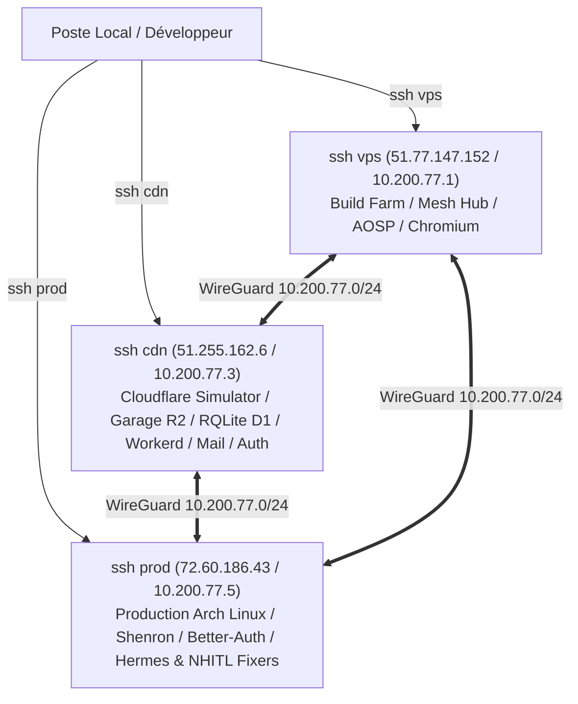

# Triade d'Infrastructure Souveraine YOLO : vps, cdn & prod

## 1. Topologie des Hotes & Roles Canoniques

L'infrastructure physique et reseau est formee par une triade d'hotes interconnectes par un maillage WireGuard Noise Protocol bare-metal et pilotee par des cles Ed25519 :



| Hote SSH | IP Publique / WireGuard | OS & Kernel | Role Fondateur & Composants |
|---|---|---|---|
| **`ssh vps`** | `51.77.147.152` / `10.200.77.1` | Ubuntu 7.3.0 generic | **Build Farm & Hub Maillage** : Compilations lourdes Chromium, CEF, AOSP, Nix, noyaux Arch/WSL, coordination du mesh WireGuard. |
| **`ssh cdn`** *(ex-bunos)* | `51.255.162.6` / `10.200.77.3` | Ubuntu 7.3.0 generic | **Simulateur Cloudflare Edge au Pixel Pres & Passerelle Multi-Cloud** : Pingora Gateway, Garage R2 S3, RQLite D1 (Raft SQLite), Workerd (Cloudflare Workers natif), passerelle Mail & Auth, pont de synchro Google/GitHub/Cloudflare/Neon/Supabase. |
| **`ssh prod`** | `72.60.186.43` / `10.200.77.5` | Arch Linux 7.2.11 bare-metal | **Production Rolling-Release** : Sites Next.js/Dioxus, Bots Discord, PostgreSQL/Redis, instances WASM/WGPU, agents Hermes / OpenCode / YOLO-AI NHITL Fixers. |

---

## 2. `ssh cdn` : Le Simulateur Cloudflare & Hub Passerelle Edge

Ce serveur emule rigoureusement l'ensemble de l'ecosysteme Cloudflare sans frais de souscription :

1. **Runtimes Workers & Serverless** :
   - Moteur `workerd` (le moteur C++ open source exact de Cloudflare Workers) execute en daemon (`yolo-cf-workerd.service`).
   - Configuration Cap'n Proto (`/opt/yolo-cf/workerd/config.capnp`) permettant d'executer n'importe quel code Worker TypeScript sans modification.
2. **Stockage R2 (S3 Compatible)** :
   - Daemon `garage` en Rust (`yolo-cf-garage.service`) fournissant une API S3 locale distribuee a latence zero sur disque NVMe.
3. **Base de Donnees D1 (Edge SQLite Replicateur)** :
   - Cluster `rqlited` (`yolo-cf-rqlite.service`) repliquant SQLite entre `vps`, `cdn` et `prod` via consensus Raft.
4. **Passerelle & Reverse Proxy L4/L7** :
   - Passerelle `yolo-cf-gateway` batie sur **Cloudflare Pingora** (Rust) gerant le routage, la terminaison TLS et le rate limiting.
5. **Ponts de Synchronisation Universelle** :
   - Scripts et daemons de synchronisation d'etats pour :
     - **Google Cloud** : synchronisation des snapshots vers Cloud Storage Coldline.
     - **GitHub** : synchronisation bi-directionnelle des git-hooks et CI/CD releases.
     - **Neon & Supabase** : miroirs de schema et de tables d'authentification (`better_auth.db`).
     - **Serveur Mail & Serveur Auth** : serveur SMTP/IMAP et autorite OIDC/OAuth2 Better-Auth.

---

## 3. `ssh prod` : Plateforme de Production Autonome (NHITL)

1. **Arch Linux Rolling-Release** :
   - Derniers packages binaires, support de `systemd-nspawn`, conteneurs Docker/Podman sans surcouche.
2. **Services de Production Actifs** :
   - `shenron-gateway`, `shenron-site`, `shenron-bot`, `shenron-chat`, `shenron-postgres`, `shenron-redis`.
   - Moteur d'authentification sans mot de passe `better_auth.db` (Argon2id, WebAuthn Passkeys).
3. **Escadre d'Agents Autonomes NHITL (No Human In The Loop)** :
   - **Hermes Agent** : orchestration des taches de monitoring et d'alertes proactives.
   - **OpenCode & YOLO-AI Fixers** : daemons locaux surveillant les logs de production, detectant les erreurs 5xx et appliquant des correctifs de code ou des redemarrages de services de maniere autonome.
   - **Auto-Deploy & Versioning** : detection des commits Git sur `main`, execution des suites de tests unitaires Bun/Rust, construction des images ou binaires AOT, et bascule sans interruption de service (*zero-downtime rolling reload*).

---

## 4. Configuration d'Acces SSH Directe

La configuration SSH client locale (`~/.ssh/config`) a ete mise a jour pour offrir des alias universels directs :

```ssh-config
Host vps
    HostName 51.77.147.152
    User ubuntu
    IdentityFile C:/Users/aphro/.ssh/id_ed25519_aphrody

Host cdn
    HostName 51.255.162.6
    User ubuntu
    IdentityFile C:/Users/aphro/.ssh/id_ed25519_aphrody

Host prod
    HostName 72.60.186.43
    User root
    IdentityFile C:/Users/aphro/.ssh/yolo_prod_ed25519
```

Chaque hote est accessible immediatement en ligne de commande : `ssh vps`, `ssh cdn`, `ssh prod`.
