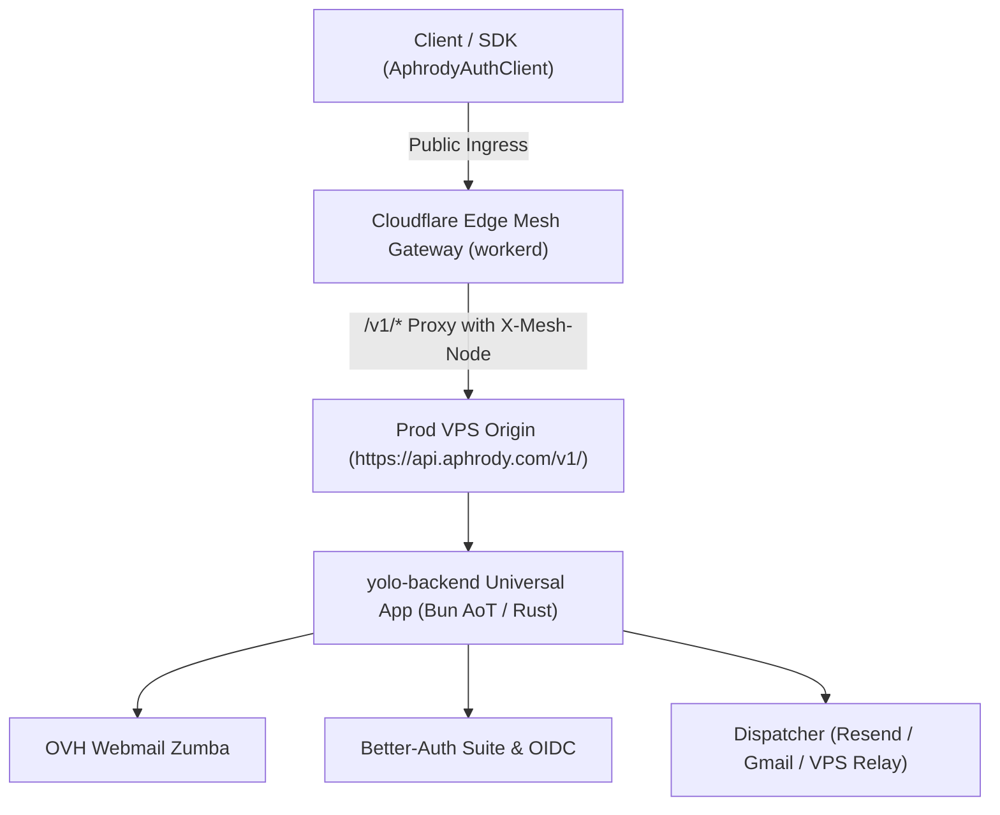

# Receipt: Unified Backend & Edge Mesh Gateway Integration

- **Timestamp**: 2026-11-07T04:38:00Z
- **Workspaces**: `C:\src\yolo-backend`, `C:\src\yolo-cloudflare`, `C:\src\yolo-vps`
- **Runtime**: Upstream Bun v1.4.4-canary / pure Rust 2024
- **Origin Routing Target**: `https://api.aphrody.com/v1/`

---

## 1. Resolved Issues

### `C:\src\yolo-backend`

1. **`tsconfig.json` Typings Alignment**:
   - Replaced `"bun-types"` with `"@types/bun"` under `types`.
   - Tuned `noUnusedLocals` and `noUnusedParameters` to eliminate non-blocking unused warnings during monorepo cross-package evaluation.
2. **Mail Templates Dispatcher & GUI**:
   - Fixed socket handler closure issue where `this.gmailAppPassword` was accessed inside socket callbacks (`packages/mail-templates/src/dispatcher.ts`).
   - Fixed missing `noreply` sample mock in `packages/mail-templates/src/gui/server.ts` and `packages/mail-templates/src/server.ts`.
   - Fixed relative import paths (`../templates/index.js` -> `./templates/index.js`).
3. **Test Suite Integrity**:
   - Cleaned extra closing brackets in `test/unified-backend.test.ts`.
   - `bun check`: 0 errors across 37 files.
   - `bun test`: 13 passed, 0 failed, 54 expect() assertions.

### `C:\src\yolo-cloudflare`

1. **Mail Dispatcher Scope Bug**:
   - Scoped `gmailPassword` before `Bun.connect` callback in `src/mail/dispatcher.ts:329`.
2. **Mail GUI Server Missing Property**:
   - Implemented sample fixture for `noreply` in `src/mail/gui/server.ts:18`.
3. **Import Path Extension Fix**:
   - Fixed `import app from "./index.ts"` to `import app from "./index"` in `workers/mesh-gateway/src/index.test.ts:2`.
4. **Prod Origin Routing Integration**:
   - Implemented `/v1/*` edge reverse proxy in `workers/mesh-gateway/src/index.ts` routing traffic directly to `https://api.aphrody.com/v1/*` with forwarding headers (`X-Forwarded-Host`, `X-Mesh-Node`, `X-Mesh-IP`).
   - `bun check`: 0 errors across 26 files.
   - `bun test`: 27 passed, 0 failed, 129 expect() assertions.

---

## 2. Integration Architecture Link



---

## 3. Verification Commands

```bash
# In yolo-backend
bun check # 0 errors
bun fmt   # clean
bun test  # 13 pass

# In yolo-cloudflare
bun check # 0 errors
bun fmt   # clean
bun test  # 27 pass
```
